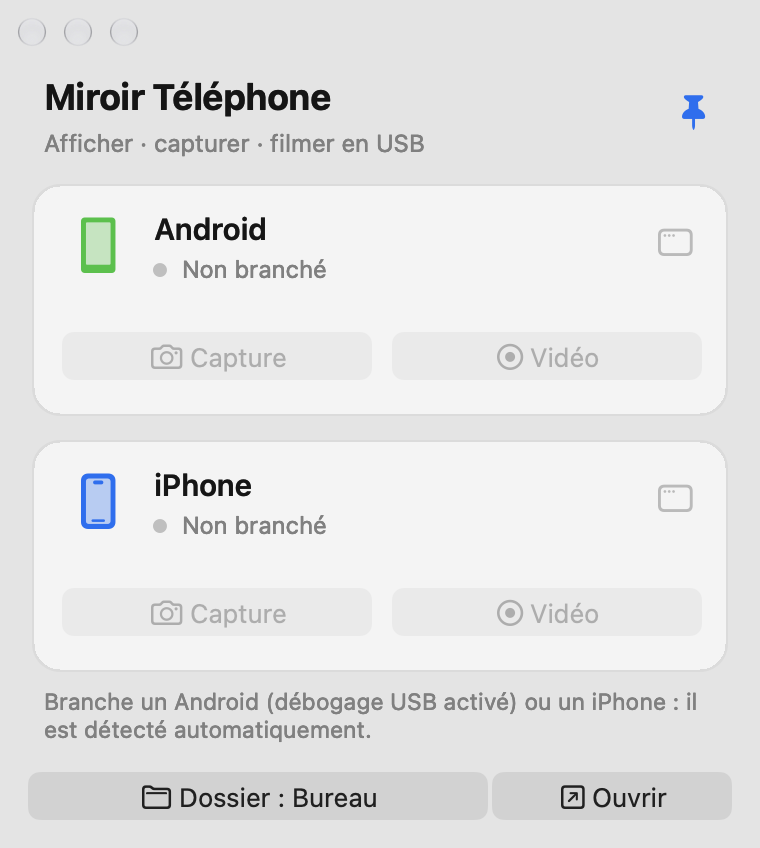

<p align="center"></p>

# Miroir Téléphone

Petit panneau macOS pour **afficher, capturer et filmer l'écran d'un Android et d'un iPhone** branchés en USB, sans rien installer sur les téléphones. Pratique pour la recette mobile et les rapports d'anomalie.

<p align="center"></p>

| | Android | iPhone |
|---|---|---|
| Miroir | [scrcpy](https://github.com/Genymobile/scrcpy) | QuickTime Player |
| Capture (PNG) | `adb screencap` | capture de la fenêtre QuickTime |
| Vidéo | `scrcpy --record` (MP4) | enregistrement QuickTime (MOV) |

## Fonctionnalités

- Détection automatique au branchement : le miroir s'ouvre tout seul.
- **Pilotage complet** : clavier et souris du Mac contrôlent le téléphone dans la fenêtre du miroir.
- **Qualité réglable** (Standard / Haute / Max) : définition, débit et images par seconde, pour le miroir comme pour les vidéos.
- **Plein écran** en un clic (`⌘F` dans le miroir pour en sortir).
- **Sans fil** : un clic passe le téléphone en Wi-Fi, puis le câble peut être débranché. L'adresse est mémorisée et la reconnexion est automatique. Un nouveau clic revient à l'USB.
- **Envoi de fichiers** : un APK est installé, les autres fichiers vont dans *Téléchargements*. Le glisser-déposer sur la fenêtre du miroir fait la même chose.
- **Partage sur le réseau local** : copie la commande `scrcpy --tcpip=IP:5555` pour qu'un collègue voie et pilote le téléphone. Le téléphone demande d'autoriser chaque nouveau poste.
- Bouton **Miroir** sur chaque appareil : ramène la vue au premier plan, ou la rouvre si elle a été fermée, réduite ou s'est figée. Un miroir Android resté sans fenêtre est relancé automatiquement.
- **Test automatique (Android)** : colle une consigne en langage naturel (étapes et résultats attendus) puis clique sur **Lancer**. Un agent Claude Code rejoue les étapes sur le téléphone via `adb` et vérifie chaque résultat attendu. Trois verdicts : **réussi**, **en échec** (le comportement testé n'est pas celui attendu) ou **bloqué** (téléphone verrouillé, appli absente, consigne ambiguë, incident technique). Un incident technique (agent sans conclusion) est relancé une fois ; un échec constaté ne l'est jamais. Preuves dans un dossier `Test_<date>/` : `rapport.txt`, `video.mp4` de toute l'exécution, une capture `etape_NN.png` par étape et `fin.png`. Nécessite Claude Code (`claude`) connecté sur le Mac.
  - **Écran allégé (A1)** : le runner copie `ecran.sh` dans le dossier de travail du test ; il renvoie une ligne par élément utile (`texte | id | clic:oui/non | x,y`) au lieu du XML brut d'`uiautomator` (environ 40 fois moins de données, donc moins de jetons). Le dump brut reste disponible si besoin.
  - **Rapide / Précis (A2)** : menu à côté de **Lancer**. Rapide = `claude-sonnet-5-5`, Précis = `claude-opus-5-5` (liste blanche codée en dur, revalidée par le runner ; tout autre mode est refusé). Le rapport indique le modèle utilisé.
  - **Paramètres et PIN (A3)** : l'engrenage ouvre la fenêtre Paramètres, où l'on enregistre le PIN du téléphone connecté. Il est stocké dans le **trousseau macOS** (service `miroir-telephone-pin`, compte = numéro de série), jamais dans un fichier ni sur GitHub. Avant un test, si le téléphone est verrouillé et qu'un PIN existe, le runner le déverrouille ; sinon le test est **bloqué** avec un message explicite.
  - **Squash TM : panneau, rejeu et rapports (lot C, v1.5.0, lecture seule)** :
    - **Paramètres → Squash** : adresse de l'API (aucune par défaut : tant qu'elle n'est pas saisie, le panneau Squash affiche « Configure l'adresse de Squash dans Paramètres ⚙︎ » et aucune requête n'est faite ; `https://` obligatoire, nom d'hôte valide sans `@`, espace, `?` ni `#`, port facultatif, chemin terminé par `/api/rest/latest` ; préférence locale, jamais écrite dans le dépôt), token (champ masqué, stocké dans le **trousseau macOS**, service `miroir-telephone-squash`, compte = hôte saisi, jamais dans un fichier ni sur GitHub ; **si tu changes d'hôte, il faut ressaisir le token**, et un token d'une ancienne version n'est jamais réutilisé) et bouton **Tester la connexion** (« Connecté (N projets visibles) » ou une erreur claire : 401 token invalide ou expiré, réseau…). L'app **ne fait que lire** Squash : `src/squash.sh` n'accepte que `GET` et une liste blanche de chemins.
    - **Panneau Squash** (bouton à gauche de l'engrenage) : la fenêtre s'élargit vers la gauche, le panneau d'origine reste à droite. Menu de projets, arbre dossiers → cas de test chargé à l'ouverture de chaque dossier, case à cocher par cas (la case d'un dossier coche ou décoche les cas déjà chargés), filtre par nom sur les nœuds chargés, colonne verdict (⏳ ✅ ❌ ⚠️).
    - **Rejouer la sélection** : chaque cas coché est lu dans Squash (nom, référence, prérequis, étapes et résultats attendus, HTML converti en texte), transformé en consigne puis rejoué un par un par le runner (mode Rapide / Précis courant). Un **échec** n'interrompt pas la suite ; un test **bloqué** l'arrête (les cas restants ne sont pas exécutés) ; **Stop** arrête toute la campagne. Barre d'état : `3/5 · 2 ✅ 1 ❌`.
    - **Preuves et rapports** : un dossier `Test_<date>_TC<id>/` par cas (rapport.txt, video.mp4, captures, `cas.json` structuré, `rapport.html`) et un `Campagne_<date>.html` dans le dossier de sortie (tableau cas / verdict / raison / lien, totaux). Le bouton **Rapport de campagne** l'ouvre. Tout texte inséré dans le HTML est échappé.
- **Voix du Mac dans les vidéos Android (v1.6.0)** : pour commenter un bug à voix haute pendant que tu filmes le téléphone. Paramètres → **Son des vidéos** → menu **Micro du Mac** (Désactivé, ou l'un des micros détectés ; par défaut « Micro MacBook Pro »). Pendant la vidéo, ffmpeg (`brew install ffmpeg`) enregistre le micro en parallèle de scrcpy ; le bouton Vidéo affiche 🎙 à côté du chronomètre. À l'arrêt, **⏳ Ajout du son…** : la voix est mixée avec le son du téléphone (ou utilisée seule si la vidéo n'en a pas), recalée d'après le décalage mesuré entre les deux démarrages, puis **un seul fichier** `Android_<date>.mp4` est déposé dans le dossier de sortie (la vidéo n'est pas ré-encodée). Tout le travail (enregistrement scrcpy, fusion) se fait dans le cache `~/Library/Caches/MiroirTelephone/micro/` ; le dossier de sortie ne reçoit qu'une copie du fichier final, jamais de fichier caché ni de renommage. Si la fusion échoue, elle est retentée une fois avec un filtre plus simple (voix seule, sans mixage) ; si elle échoue encore, la vidéo seule est livrée et la voix (`micro_<date>.m4a`) reste dans le cache, avec le journal `fusion_<date>.log` dont le chemin est affiché dans le statut. Après un arrêt brutal, les fichiers temporaires du cache sont purgés au bout de 24 h et les m4a au bout de 7 jours. Si le micro est indisponible, la vidéo continue sans micro. L'enregistrement du micro est limité à 3 h et s'arrête toujours avec l'app.
- Captures et vidéos horodatées (`Android_2026-11-16_10-24-08.png`, `iPhone_….mov`), avec un son à l'enregistrement.
- Chronomètre et bouton rouge pendant une vidéo ; une vidéo Android est finalisée proprement si le téléphone est débranché.
- Dossier de sortie au choix (Bureau par défaut), mémorisé.
- Fenêtre flottante (épingle) pour rester au-dessus du miroir ; position mémorisée.
- Raccourcis : `⌘5` miroir Android, `⌘6` miroir iPhone, `⌘1` capture Android, `⌘2` vidéo Android, `⌘3` capture iPhone, `⌘4` vidéo iPhone, `⌘O` ouvrir le dossier, `⌘Q` quitter.
- Clair / sombre automatique.

## Installation

```sh
brew install scrcpy          # fournit aussi adb
git clone https://github.com/JulienElasriQA/miroir-telephone.git
cd miroir-telephone
./build.sh --install         # crée /Applications/Miroir Téléphone.app
```

Ensuite, lancez **Miroir Téléphone** depuis Spotlight, le Launchpad ou le Dock.

### Premier lancement

- **Android** : activez le débogage USB (Options pour les développeurs) et acceptez l'empreinte du Mac sur le téléphone.
- **iPhone** : dans QuickTime, cliquez sur la flèche ˅ à côté du bouton rouge, puis choisissez l'iPhone comme caméra et micro. Depuis macOS 27, la source n'est plus sélectionnable par script.
- **Micro (vidéos Android)** : à la première vidéo avec micro, macOS demande d'autoriser **Miroir Téléphone** à utiliser le micro. Si tu as refusé : Réglages Système → Confidentialité et sécurité → **Micro** → active « Miroir Téléphone » (la vidéo se fait sans micro tant que ce n'est pas fait).
- macOS demande d'autoriser **Miroir Téléphone** à piloter QuickTime Player (Automatisation). Pour la capture iPhone, il faut aussi l'autoriser dans Réglages → Confidentialité → **Enregistrement de l'écran**.

## Fonctionnement

L'app est un script [JXA](https://developer.apple.com/library/archive/releasenotes/InterapplicationCommunication/RN-JavaScriptForAutomation/) (`src/miroir.js`) qui construit une interface Cocoa native. `build.sh` l'emballe dans un bundle `.app` avec une icône générée par `scripts/make-icon.js`. Il n'y a ni dépendance npm ni Xcode.

- Lancer sans bundle : `osascript -l JavaScript src/miroir.js`
- Vérifier le rendu sans écran : `MIROIR_SNAPSHOT=/tmp/ui.png osascript -l JavaScript src/miroir.js`. Variantes : `MIROIR_SNAPSHOT_SETTINGS=1` (fenêtre Paramètres), `MIROIR_SNAPSHOT_SQUASH=1` (panneau Squash ouvert ; `MIROIR_SNAPSHOT_PROJECT=<id>`, `MIROIR_SNAPSHOT_FOLDER=<id>` et `MIROIR_SNAPSHOT_CHECK=<n>` pour déplier un dossier et cocher ses n premiers cas).
- Tester l'enchaînement d'une campagne sans téléphone ni Claude : `MIROIR_RUNNER=/chemin/runner-factice.sh` remplace `test-runner.sh` (mêmes arguments : série, dossier de travail, dossier de sortie, horodatage, mode ; il écrit `resultat.txt` et le dossier `Test_<horodatage>/`). `MIROIR_SNAPSHOT_CAMPAIGN=1` est autonome (il ouvre le panneau lui-même ; avec `MIROIR_SNAPSHOT_PROJECT` / `_FOLDER` / `_CHECK`) et joue la campagne des cas cochés jusqu'au bout avant la capture. Ces variables sont réservées aux essais depuis les sources (le lanceur du bundle les neutralise) ; avec un runner factice ou en mode capture, l'app n'émet ni notification ni son.
- Journaux : `~/Library/Logs/MiroirTelephone.log` (app) et `~/Library/Logs/MiroirTelephone-scrcpy.log` (scrcpy)

## Windows / Linux — ⚠️ expérimental

Le dossier [`portable/`](portable/) contient un portage en Python (customtkinter). Les exécutables sont dans les [Releases](../../releases), marqués *pre-release*. Ce portage est testé automatiquement par GitHub Actions sur Windows et Ubuntu (interface, installation de scrcpy, exécutable), mais **pas encore avec un vrai téléphone**.

| | Windows / Linux |
|---|---|
| Android | miroir piloté au clavier et à la souris, capture PNG, vidéo MP4, qualité réglable, plein écran, sans fil, envoi de fichiers, partage sur le réseau local |
| iPhone | recopie AirPlay seulement, via [UxPlay](https://github.com/FDH2/UxPlay) s'il est installé ; ni capture ni vidéo |
| Droits admin | aucun dans la plupart des cas (voir ci-dessous) |

**Sans admin :**
- Si scrcpy est absent, le bouton **Installer** télécharge la version officielle (adb compris) dans `%LOCALAPPDATA%\MiroirTelephone` ou `~/.local/share/miroir-telephone`, et vérifie sa somme SHA-256.
- `install-windows.ps1` (Menu Démarrer et Bureau) et `install-linux.sh` (menu des applications) n'installent que pour l'utilisateur courant.
- Pour lancer depuis les sources : `pip install --user -r portable/requirements.txt && python portable/miroir.py`. Sous Linux, tkinter est requis (`python3-tk`).

**Avec admin, seulement si nécessaire :**
- Linux, si la carte indique « Accès USB refusé » (règle udev, une seule fois) :
  ```sh
  echo 'SUBSYSTEM=="usb", ATTR{idVendor}=="04e8", MODE="0660", TAG+="uaccess"' | sudo tee /etc/udev/rules.d/51-android.rules
  sudo udevadm control --reload-rules && sudo udevadm trigger
  ```
  `04e8` correspond à Samsung : remplacez-le par l'identifiant constructeur affiché par `lsusb`. Beaucoup de distributions fournissent déjà ces règles (paquet `android-sdk-platform-tools-common` ou `android-udev-rules`).
- Windows, si le téléphone n'apparaît pas : installez le pilote USB du constructeur (par exemple *Samsung USB Driver*).

**Différences avec la version macOS :**
- Sous Windows, la vidéo s'enregistre depuis la fenêtre du miroir, renommée « Android - enregistrement ». Arrêter la vidéo ferme cette fenêtre, ce qui finalise le MP4, puis le miroir normal revient.
- Sous Linux, le bouton Miroir ramène la fenêtre au premier plan si `wmctrl` ou `xdotool` est présent. Sinon, il relance le miroir.
- Les binaires scrcpy officiels n'existent pas pour Linux ARM : installez scrcpy avec votre distribution.

## Correspondance avec Vysor Pro

| Vysor Pro | Miroir Téléphone |
|---|---|
| Miroir et contrôle | ✓ (scrcpy) |
| Captures | ✓ (vidéo en plus) |
| Miroir haute qualité | ✓ Standard / Haute / Max |
| Plein écran | ✓ |
| Sans fil | ✓ adb Wi-Fi, reconnexion automatique |
| Glisser-déposer de fichiers | ✓ sur le miroir, et bouton « Envoyer » |
| Vysor Share (lien Internet) | partiel : réseau local uniquement. Un partage par lien demanderait un serveur relais et ouvrirait un accès adb distant, ce qui pose un sujet de sécurité |
| Contrôle de l'iPhone | ✗ : Apple ne le permet pas sans jailbreak. Affichage seul |

**Sécurité du mode sans fil :** adb écoute sur le port 5555 du réseau Wi-Fi. Chaque nouvel ordinateur doit être autorisé sur le téléphone, mais ce mode est à éviter sur un réseau public. Pour le couper, recliquez sur le bouton ou redémarrez le téléphone.

## Limites connues

- Le recalage voix / vidéo Android est mesuré à environ 0,1 s près (instants de création des fichiers par scrcpy et ffmpeg). La voix n'est pas disponible pour l'iPhone (son géré par QuickTime).
- La vidéo iPhone passe par QuickTime, qui est sandboxé : le fichier est d'abord écrit dans `~/Movies/MiroirTelephone`, puis déplacé.
- Un seul appareil Android est géré à la fois (le premier listé par `adb devices`).
