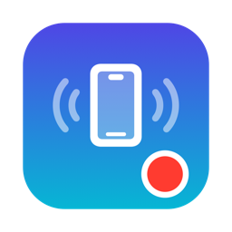

<p align="center"></p>

# Miroir Téléphone

Petit panneau macOS pour **afficher, capturer et filmer l'écran d'un Android et d'un iPhone** branchés en USB, sans rien installer sur les téléphones. Pratique pour la recette mobile et les rapports d'anomalie.

<p align="center"></p>

| | Android | iPhone |
|---|---|---|
| Miroir | [scrcpy](https://github.com/Genymobile/scrcpy) | QuickTime Player |
| Capture (PNG) | `adb screencap` | capture de la fenêtre QuickTime |
| Vidéo | `scrcpy --record` (MP4) | enregistrement QuickTime (MOV) |

## Fonctionnalités

- Détection automatique au branchement : le miroir s'ouvre tout seul.
- Bouton **Miroir** sur chaque appareil : ramène la vue au premier plan, ou la rouvre si elle a été fermée, réduite ou s'est figée. Un miroir Android resté sans fenêtre est relancé automatiquement.
- Captures et vidéos horodatées (`Android_2026-11-16_10-24-08.png`, `iPhone_….mov`), avec un son à l'enregistrement.
- Chronomètre et bouton rouge pendant une vidéo ; une vidéo Android est finalisée proprement si le téléphone est débranché.
- Dossier de sortie au choix (Bureau par défaut), mémorisé.
- Fenêtre flottante (épingle) pour rester au-dessus du miroir ; position mémorisée.
- Raccourcis : `⌘5` miroir Android, `⌘6` miroir iPhone, `⌘1` capture Android, `⌘2` vidéo Android, `⌘3` capture iPhone, `⌘4` vidéo iPhone, `⌘O` ouvrir le dossier, `⌘Q` quitter.
- Clair / sombre automatique.

## Installation

```sh
brew install scrcpy          # fournit aussi adb
git clone https://github.com/JulienElasriQA/miroir-telephone.git
cd miroir-telephone
./build.sh --install         # crée ~/Applications/Miroir Téléphone.app
```

Ensuite, lancez **Miroir Téléphone** depuis Spotlight, le Launchpad ou le Dock.

### Premier lancement

- **Android** : activez le débogage USB (Options pour les développeurs) et acceptez l'empreinte du Mac sur le téléphone.
- **iPhone** : dans QuickTime, cliquez sur la flèche ˅ à côté du bouton rouge, puis choisissez l'iPhone comme caméra et micro. Depuis macOS 27, la source n'est plus sélectionnable par script.
- macOS demande d'autoriser **Miroir Téléphone** à piloter QuickTime Player (Automatisation). Pour la capture iPhone, il faut aussi l'autoriser dans Réglages → Confidentialité → **Enregistrement de l'écran**.

## Fonctionnement

L'app est un script [JXA](https://developer.apple.com/library/archive/releasenotes/InterapplicationCommunication/RN-JavaScriptForAutomation/) (`src/miroir.js`) qui construit une interface Cocoa native. `build.sh` l'emballe dans un bundle `.app` avec une icône générée par `scripts/make-icon.js`. Il n'y a ni dépendance npm ni Xcode.

- Lancer sans bundle : `osascript -l JavaScript src/miroir.js`
- Vérifier le rendu sans écran : `MIROIR_SNAPSHOT=/tmp/ui.png osascript -l JavaScript src/miroir.js`
- Journaux : `~/Library/Logs/MiroirTelephone.log` (app) et `~/Library/Logs/MiroirTelephone-scrcpy.log` (scrcpy)

## Windows / Linux — ⚠️ expérimental

Le dossier [`portable/`](portable/) contient un portage en Python (customtkinter). Les exécutables sont dans les [Releases](../../releases), marqués *pre-release*. Ce portage est testé automatiquement par GitHub Actions sur Windows et Ubuntu (interface, installation de scrcpy, exécutable), mais **pas encore avec un vrai téléphone**.

| | Windows / Linux |
|---|---|
| Android | miroir, capture PNG et vidéo MP4 (scrcpy) |
| iPhone | recopie AirPlay seulement, via [UxPlay](https://github.com/FDH2/UxPlay) s'il est installé ; ni capture ni vidéo |
| Droits admin | aucun dans la plupart des cas (voir ci-dessous) |

**Sans admin :**
- Si scrcpy est absent, le bouton **Installer** télécharge la version officielle (adb compris) dans `%LOCALAPPDATA%\MiroirTelephone` ou `~/.local/share/miroir-telephone`, et vérifie sa somme SHA-256.
- `install-windows.ps1` (Menu Démarrer et Bureau) et `install-linux.sh` (menu des applications) n'installent que pour l'utilisateur courant.
- Pour lancer depuis les sources : `pip install --user -r portable/requirements.txt && python portable/miroir.py`. Sous Linux, tkinter est requis (`python3-tk`).

**Avec admin, seulement si nécessaire :**
- Linux, si la carte indique « Accès USB refusé » (règle udev, une seule fois) :
  ```sh
  echo 'SUBSYSTEM=="usb", ATTR{idVendor}=="04e8", MODE="0660", TAG+="uaccess"' | sudo tee /etc/udev/rules.d/51-android.rules
  sudo udevadm control --reload-rules && sudo udevadm trigger
  ```
  `04e8` correspond à Samsung : remplacez-le par l'identifiant constructeur affiché par `lsusb`. Beaucoup de distributions fournissent déjà ces règles (paquet `android-sdk-platform-tools-common` ou `android-udev-rules`).
- Windows, si le téléphone n'apparaît pas : installez le pilote USB du constructeur (par exemple *Samsung USB Driver*).

**Différences avec la version macOS :**
- Sous Windows, la vidéo s'enregistre depuis la fenêtre du miroir, renommée « Android - enregistrement ». Arrêter la vidéo ferme cette fenêtre, ce qui finalise le MP4, puis le miroir normal revient.
- Sous Linux, le bouton Miroir ramène la fenêtre au premier plan si `wmctrl` ou `xdotool` est présent. Sinon, il relance le miroir.
- Les binaires scrcpy officiels n'existent pas pour Linux ARM : installez scrcpy avec votre distribution.

## Limites connues

- La vidéo iPhone passe par QuickTime, qui est sandboxé : le fichier est d'abord écrit dans `~/Movies/MiroirTelephone`, puis déplacé.
- Un seul appareil Android est géré à la fois (le premier listé par `adb devices`).
